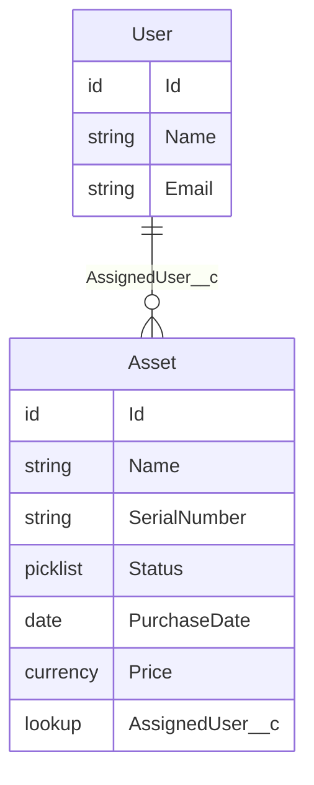

# Architecture Overview: asset-tracker

## Data Model



## Component Map

```
Asset (standard object, Private OWD)
│
├── AssetTracker_ITAdmin (permission set)
│   └── Standard Asset List View + Record Page
│       └── IT Admin creates, assigns, returns laptops
│
├── AssetTracker_Employee (permission set)
│   └── Sharing Rule → Employee sees own record
│       └── myLaptops (LWC)
│           └── Employee App Page (Lightning App Page)
│
├── AssetTrackerController (Apex, with sharing)
│   └── getMyLaptops() — queries Assets WHERE AssignedUser__c = current user
│       └── consumed by myLaptops LWC via @wire / imperative call
│
└── AssetAssignmentNotification (Record-Triggered Flow, after save)
    ├── Fires when AssignedUser__c changes or Status changes to/from Assigned
    └── Send Email action → assigned employee
```

## Metadata Inventory

| Type | API Name | Purpose |
|------|----------|---------|
| Custom Field | Asset.AssignedUser__c | Links asset to a Salesforce User |
| Picklist Value Set | Asset.Status | Available, Assigned, Retired |
| Validation Rule | Asset.No_Assign_Retired | Blocks assigning a retired asset |
| Permission Set | AssetTracker_ITAdmin | Full CRUD + View/Modify All on Asset |
| Permission Set | AssetTracker_Employee | Read on Asset (own records via sharing) |
| *(no sharing rule)* | — | Employee isolation enforced by controller query filter (ADR-006) |
| Apex Class | AssetTrackerController | getMyLaptops() service method |
| Apex Test Class | AssetTrackerControllerTest | Covers ACs 1–8 |
| LWC | myLaptops | Employee-facing assigned laptops view |
| Flow | AssetAssignmentNotification | Email on assignment/return |
| Lightning App Page | AssetTrackerEmployeePage | Hosts myLaptops LWC |
